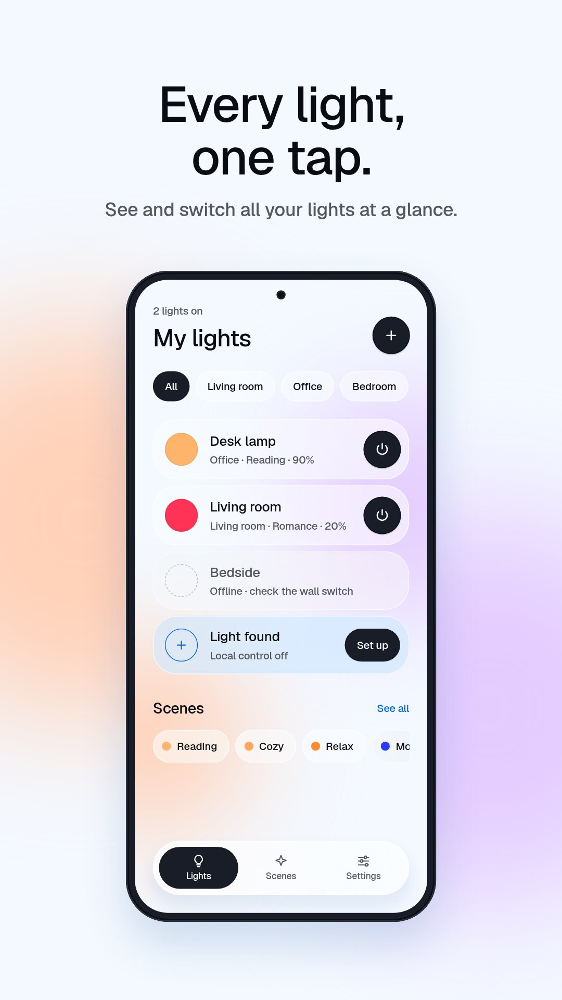
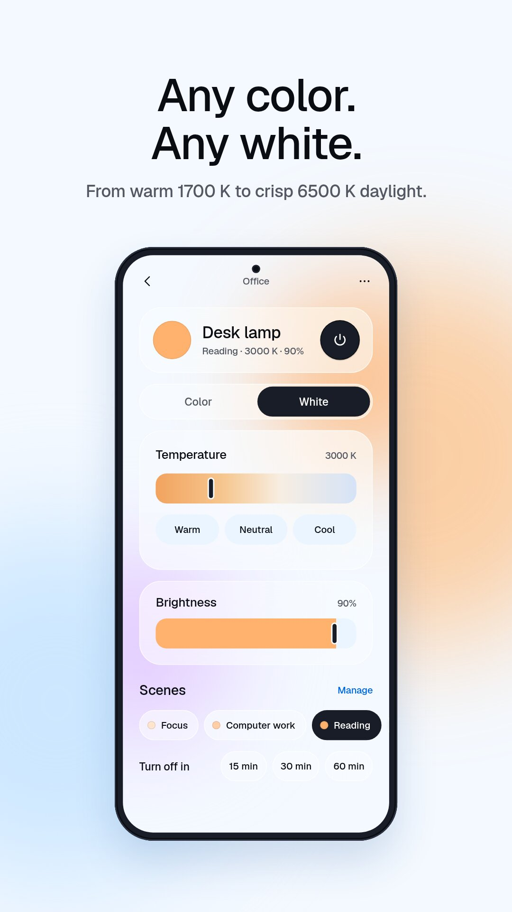
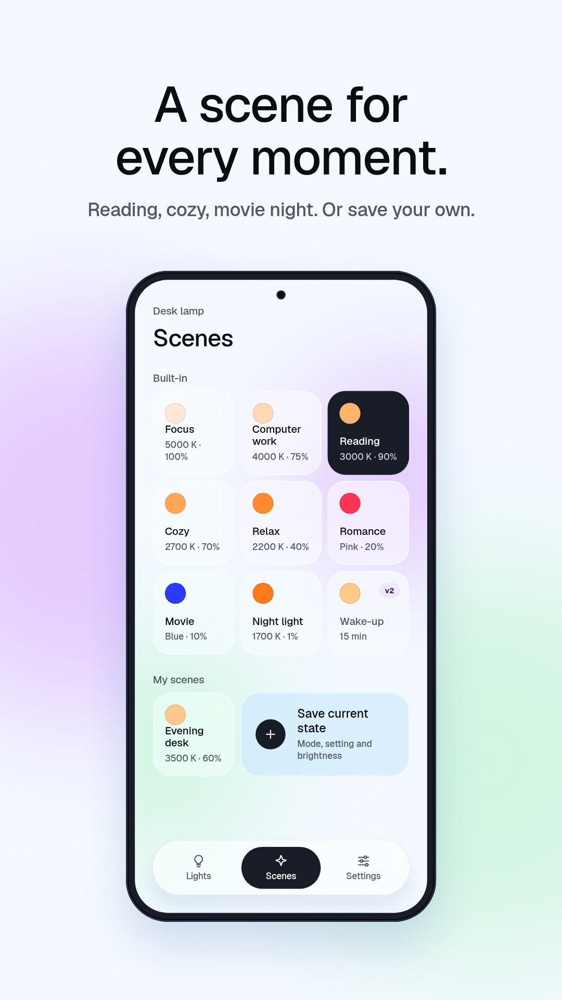
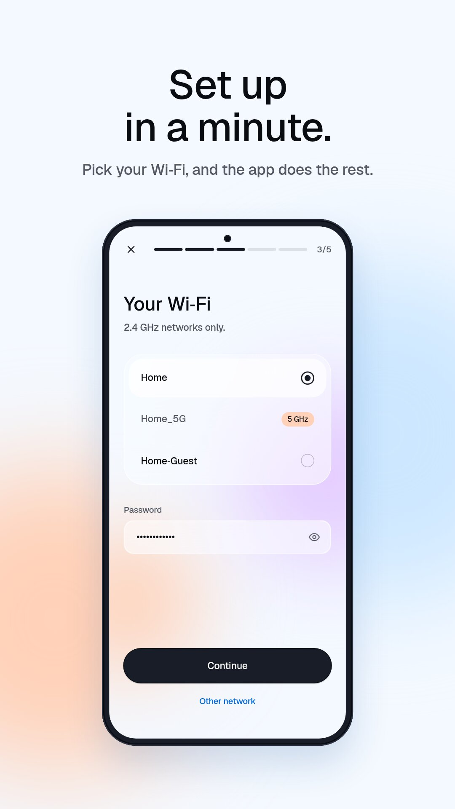
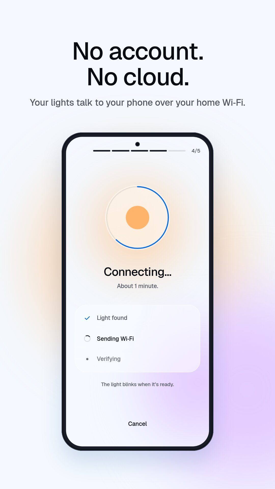

# Lumière

Control your Yeelight bulbs over your home Wi‑Fi, with no account and no cloud.

Lumière talks to your lamps directly on your local network. Nothing goes through a remote server: no sign-up, no analytics, no ads, no trackers. Your lamps keep working when your internet connection is down.

<p align="center">
  
  
  
  
  
</p>

## Features

- Turn lamps on and off from the home screen
- Brightness from 1 to 100 %
- Any color, or a white from warm 1700 K to cool 6500 K
- Scenes: Focus, Reading, Cozy, Relax, Cinema, Night light and more, plus your own
- Sleep timer: turn off in 15, 30 or 60 minutes
- Wake-up: a 15-minute sunrise from dim amber to bright white
- Add a new lamp from the app in about a minute
- English and French

## Privacy

Lumière collects no data. Your lamps, their names and your scenes are stored on your phone only. When you add a new lamp, your Wi‑Fi password is sent straight to the lamp and is not kept.

The app never connects to the internet, including Yeelight's or Xiaomi's servers. It only talks to devices on your local network:

| What | How |
| --- | --- |
| Adding a new lamp | miIO over UDP 54321, on the lamp's own access point |
| Finding lamps | SSDP, then a scan of the local network |
| Controlling lamps | Yeelight LAN protocol over TCP 55443 |

Android asks for the **location** permission because it is required to list Wi‑Fi networks and read the current network name. Lumière never reads your location.

## Requirements

- Android
- Your phone and your lamps on the same Wi‑Fi network
- A 2.4 GHz network secured with WPA2 (the lamps don't support 5 GHz)
- A Yeelight Wi‑Fi bulb. Tested on the Yeelight Color bulb (`yeelink.light.color3`, firmware 2.0.6). Other Yeelight Wi‑Fi bulbs that support LAN control should work.

The trade-off of going local: you can't control your lamps when you're away from home.

## Getting started

**New lamp, or a lamp you're happy to reset**

1. In Lumière, tap **+**.
2. A new lamp is already in pairing mode. Otherwise, reset it: at the wall switch, turn it off and on 5 times in a row, about 2 seconds each time. The lamp changes color, then stays white.
3. Pick the lamp and accept Android's prompt to join its network.
4. Choose your Wi‑Fi and enter its password. The lamp blinks when it's done.

**Lamp already set up with the Yeelight app**

In the Yeelight app, open the lamp's settings and turn on **LAN Control**. The lamp then shows up in Lumière under **My lamps**, with an **Add** button.

## Building from source

```sh
npm install
npm test                 # protocol tests, plus an integration test against reference/fakebulb.py
npx tsc --noEmit -p .
npx expo prebuild -p android
cd android && ./gradlew app:assembleRelease
```

The project is an Expo / React Native app. The local network code lives in a small native module, `modules/yeenet` (Kotlin and Swift). The protocol itself is plain TypeScript in `src/protocol` and runs under Node for testing. `docs/spec.md` describes the protocol and `reference/yeelocal.py` is the original Python prototype.

## License

Lumière is free software, released under the [GNU General Public License v3.0 or later](LICENSE).

Lumière is an independent project. It is not affiliated with, endorsed or sponsored by Yeelight or Xiaomi.
